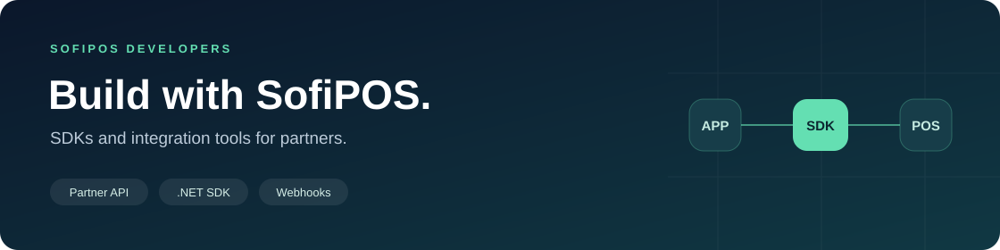

# SofiPOS SDKs

**SDK và công cụ tích hợp dành cho đối tác SofiPOS.**

[](sdks/fnb/dotnet/README.md)
[](docs/integration-guide.md)
[](LICENSE)

[Bắt đầu nhanh](docs/getting-started.md) · [SDK .NET](sdks/fnb/dotnet/README.md) · [Ứng dụng demo](examples/fnb/README.md) · [Hướng dẫn tích hợp](docs/integration-guide.md) · [Hỗ trợ](SUPPORT.md)

Kết nối ứng dụng của bạn với danh mục, thực đơn, bàn, đơn hàng và thanh toán FnB qua Partner API. SDK cung cấp model có kiểu dữ liệu, phân trang, xử lý lỗi, retry GET và kiểm tra chữ ký webhook.

## Bắt đầu tích hợp

1. Nhận API Base URL và Partner Key từ cửa hàng SofiPOS.
2. Làm theo [hướng dẫn bắt đầu](docs/getting-started.md) để tham chiếu SDK từ source hoặc dùng gói đã phát hành.
3. Đọc dữ liệu bằng SDK, sau đó triển khai luồng tạo đơn, thanh toán và webhook theo [hướng dẫn tích hợp](docs/integration-guide.md).

```csharp
using SofiPOS.FnB;
using SofiPOS.FnB.Configuration;

using var client = new SofiPosFnBClient(new SofiPosOptions
{
    BaseUrl = Environment.GetEnvironmentVariable("SOFIPOS_BASE_URL")
        ?? throw new InvalidOperationException("Thiếu SOFIPOS_BASE_URL."),
    ApiKey = Environment.GetEnvironmentVariable("SOFIPOS_API_KEY")
        ?? throw new InvalidOperationException("Thiếu SOFIPOS_API_KEY.")
});

var branches = await client.Lookups.GetBranchesAsync();
foreach (var branch in branches)
    Console.WriteLine($"{branch.Id}: {branch.Name}");
```

SDK hiện đặt version `1.0.0` trong source. Khả năng cài từ NuGet.org chỉ được xác nhận sau khi có bản phát hành; có thể bắt đầu ngay bằng `ProjectReference`.

## Cấu trúc workspace

SDK theo từng mô hình bán hàng, tách theo ngôn ngữ. Mỗi demo trong `examples/{model}` có một frontend dùng chung và các backend theo ngôn ngữ SDK.

```text
sofipos-sdks/
├── sdks/
│   └── fnb/
│       └── dotnet/
│           ├── SofiPOS.FnB.sln
│           ├── SofiPOS.FnB.Sdk/
│           ├── SofiPOS.FnB.Sdk.Tests/
│           ├── examples/SofiPOS.FnB.Example/
│           └── README.md
└── examples/
    └── fnb/
        ├── frontend/
        ├── backends/
        │   └── dotnet/
        ├── CONTRACT.md
        ├── COVERAGE.md
        └── README.md
```

## SDK hiện có

| Mô hình | Ngôn ngữ | Vị trí | Package |
|---|---|---|---|
| FnB | .NET 8+ | [sdks/fnb/dotnet](sdks/fnb/dotnet/README.md) | `SofiPOS.FnB.Sdk` |

Quy ước khi bổ sung SDK: `sdks/{model}/{language}`. Ví dụ `sdks/retail/dotnet`, `sdks/fnb/nodejs`, `sdks/retail/nodejs`. Những SDK này chưa được triển khai; không có package giả hoặc thư mục chứa code mẫu thay thế chức năng thật.

## Ứng dụng demo

[FnB SDK Lab](examples/fnb/README.md) có một frontend React dùng chung: nhập thông tin kết nối, gọi **92 thao tác Partner API** bằng form và chọn các bản ghi liên kết theo tên từ API. Có trace HTTP và webhook inbox trong RAM; không cần database hoặc đồng bộ dữ liệu trước.

Backend hiện có tại `examples/fnb/backends/dotnet`, dùng `ProjectReference` đến SDK trong workspace. Backend mới, ví dụ Node.js, đặt tại `examples/fnb/backends/nodejs` khi được triển khai và tuân theo [hợp đồng HTTP](examples/fnb/CONTRACT.md). Đổi `BACKEND_URL` để frontend gọi backend khác; không cần nhân bản frontend.

## Tài liệu API

| Tài liệu | Nội dung |
|---|---|
| [Bắt đầu nhanh](docs/getting-started.md) | Yêu cầu môi trường, cài đặt, lời gọi đầu tiên |
| [Hướng dẫn tích hợp](docs/integration-guide.md) | Xác thực, nhiều cửa hàng, đơn hàng, lỗi và webhook |
| [SDK .NET](sdks/fnb/dotnet/README.md) | Cấu hình, nhóm API và ví dụ chi tiết |
| [SDK Lab](examples/fnb/README.md) | Chạy demo .NET + React, phiên trong RAM |
| [Độ phủ chức năng](examples/fnb/COVERAGE.md) | Đối chiếu 92 thao tác SDK với form demo |
| [Changelog](CHANGELOG.md) | Thay đổi và thông tin tương thích |

Đặc tả API triển khai và bộ Postman, nếu cần, được cung cấp qua đầu mối tích hợp SofiPOS của bạn. Các hướng dẫn trong repository này có thể đọc độc lập.

## Đóng góp và hỗ trợ

- Báo lỗi hoặc đề xuất tính năng theo [hướng dẫn hỗ trợ](SUPPORT.md).
- Gửi thay đổi theo [hướng dẫn đóng góp](CONTRIBUTING.md).
- Báo cáo lỗ hổng theo [chính sách bảo mật](SECURITY.md).
- Quản trị repository và phát hành: [hướng dẫn maintainer](docs/maintainers/github.md).

## Giấy phép

Mã nguồn được cung cấp theo [MIT License](LICENSE). Thông tin kết nối và quyền truy cập Partner API do cửa hàng SofiPOS cấp riêng.
