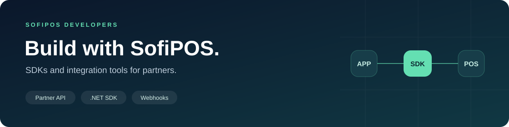

# SofiPOS Developers

**SDK và công cụ tích hợp dành cho đối tác SofiPOS.**

Kết nối ứng dụng của bạn với danh mục, thực đơn, bàn, đơn hàng, thanh toán và webhook FnB.

## Bắt đầu xây dựng

| Tài nguyên | Nội dung |
|---|---|
| [SofiPOS SDKs](https://github.com/sofipos-sdks/sofipos-sdks) | SDK, ví dụ và tài liệu tích hợp |
| [Bắt đầu nhanh](https://github.com/sofipos-sdks/sofipos-sdks/blob/main/docs/getting-started.md) | Cài đặt và thực hiện lời gọi đầu tiên |
| [SDK FnB .NET](https://github.com/sofipos-sdks/sofipos-sdks/tree/main/sdks/fnb/dotnet) | Model có kiểu dữ liệu, phân trang, xử lý lỗi và webhook |
| [SDK Lab](https://github.com/sofipos-sdks/sofipos-sdks/tree/main/examples/fnb) | Giao diện React + .NET để thực hành tích hợp |

## Kết nối với SofiPOS

- Đọc [hướng dẫn tích hợp](https://github.com/sofipos-sdks/sofipos-sdks/blob/main/docs/integration-guide.md) cho luồng đơn hàng, thanh toán và webhook.
- Gửi lỗi hoặc câu hỏi sử dụng qua [GitHub Issues](https://github.com/sofipos-sdks/sofipos-sdks/issues).
- Liên hệ đầu mối tích hợp SofiPOS của bạn để nhận API Base URL, Partner Key và hỗ trợ dữ liệu cửa hàng.
- Báo cáo lỗ hổng theo [chính sách bảo mật](https://github.com/sofipos-sdks/sofipos-sdks/blob/main/SECURITY.md).

Mã nguồn SDK được cung cấp theo [MIT License](https://github.com/sofipos-sdks/sofipos-sdks/blob/main/LICENSE).
